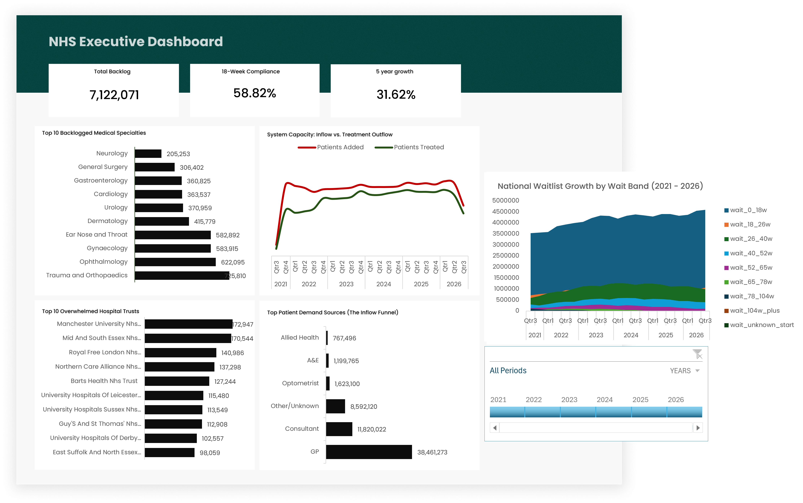

# 🏥 NHS Operations & Capacity Analysis: 5-Year Waitlist Dashboard

## 📌 Executive Summary
This project analyzes the National Health Service (NHS) elective care waitlist, which recently surpassed 7.1 million patients. Using PostgreSQL for backend data engineering and Microsoft Excel for the front-end presentation layer, I built an interactive Executive Dashboard designed to answer critical capacity and resource allocation questions for healthcare leadership.

## ⚠️ Data Quality Audit & Engineering Fix
During the initial data exploration phase in PostgreSQL, I discovered a critical data integrity issue in the raw government export. High-performing hospital trusts were returning `NULL` values instead of `0` for patients waiting over 52 weeks. 

If loaded directly into a visualization tool, these `NULL` values would mathematically drop hundreds of hospitals from the dataset, corrupting the national average. I engineered a structural fix using `COALESCE()` in the SQL Views to convert these nulls to zeros, ensuring 100% data accuracy for executive decision-making.

## 📊 Strategic Business Questions Answered
The final dashboard moves beyond standard reporting to act as an operational command center, answering five key business questions:

1. **Are we meeting our statutory mandates?** 
   * *Finding:* The volume-weighted 18-week treatment compliance rate has fallen to **~58.8%**, critically below the 92% legal mandate.
2. **Is the waitlist growing due to a demand spike or a capacity failure?** 
   * *Finding:* The 5-year waitlist growth sits at **31.62%**. The dual-line capacity chart proves a chronic structural deficit; the system consistently treats fewer patients than it admits weekly.
3. **Where is the patient inflow originating?** 
   * *Finding:* The referral funnel visualization isolates General Practitioners (GPs) as the overwhelming source of system inflow, highlighting a need for upstream community diagnostic funding.
4. **Where should emergency funding be deployed today?** 
   * *Finding:* The watchlist filters isolate the top 10 most overwhelmed facilities (led by Manchester University and Mid And South Essex) to target financial intervention.
5. **Which medical specialists must HR prioritize for recruitment?** 
   * *Finding:* Trauma/Orthopaedics and Ophthalmology alone account for over 1.3 million backlogged patients, dictating a highly targeted clinical hiring strategy.

## 🛠️ Technical Stack
* **Database:** PostgreSQL (pgAdmin 4)
* **Data Processing & Cleaning:** SQL (Views, Aggregations, COALESCE, CTEs)
* **Visualization:** Microsoft Excel (Advanced Pivot Tables, Dynamic KPI Engine, Interactive Timeline Slicers)

## 📁 Repository Contents
* **`1_sql_engineering/`**: Contains the SQL queries used to audit the raw data and build the 5 production views.
* **`2_data_exports/`**: Contains the clean CSV datasets powering the dashboard. *(Raw data omitted for size; sourced from NHS England).*
* **`3_dashboard_presentation/`**: Contains high-resolution images, PDF exports, and the fully interactive Excel dashboard file.
